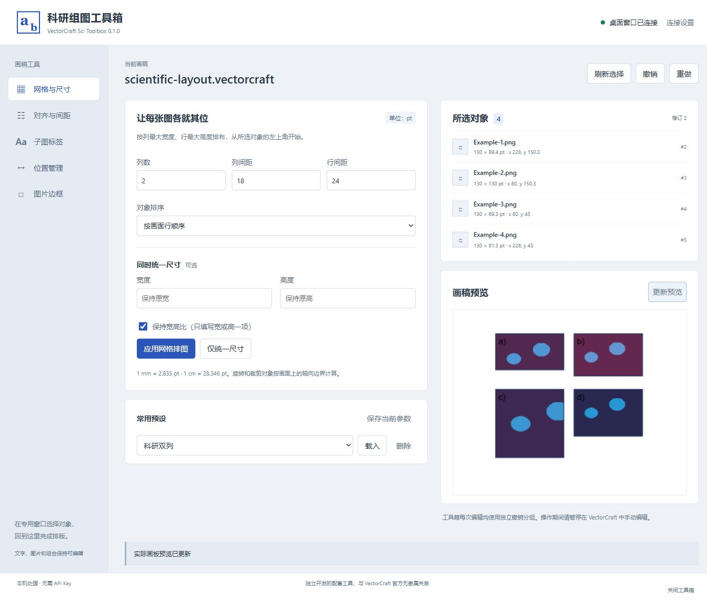

# VectorCraft 科研组图工具箱

第二版原生内嵌候选 **0.2.0-rc.2** 已通过本机完整工程检查及桌面联测，加入原生配色、比例尺、多ROI、伪彩与Screen通道合并，详情见 [定制版说明](native/README.md) 和 [验证记录](docs/native/VALIDATION-RC2.md)。GitHub 预发布版 v0.2.0-rc.2 已发布；第一版发行保留。

面向科研组图的中文桌面配套工具。选择 VectorCraft 中的图片、文字或组合，用独立面板完成网格排图、尺寸调整、子图标签、间距和位置管理。保留原始对象的可编辑性，无需 AI API 或云服务。

首版使用独立浏览器面板，通过本机控制协议连接 **VectorCraft 桌面窗口**，不是软件内停靠的 CEP 扩展。当前验证平台为 Windows x64 + VectorCraft 0.10.0。



## 首版功能

- 网格排图：列数、行列间距，按行/水平/垂直/接口返回的选择顺序排序。
- 统一尺寸：逐对象设置宽高，支持保持比例。
- 对齐、等间距：基于整体边界或第一个对象对齐。
- 子图标签：A/a/A)/a)/数字，字体、字号、颜色、四角锚点和偏移；重复运行更新已有标签。
- 位置管理：复制/粘贴绝对或相对位置，两个对象交换位置。
- 边框：添加或更新独立可编辑矩形描边。
- 常用预设、本机画稿预览、每次编辑一个撤销分组。

## Windows 快速使用

1. 安装 VectorCraft 0.10.0，下载本项目 Releases 中的 Windows 压缩包并解压。
2. 双击 `VectorCraftSciToolbox.exe`，工具箱会在默认浏览器打开。
3. 展开“连接设置”，填入 `vectorcraft.exe` 路径及**已有工作目录**，点击“启动专用窗口”。主程序常见于 `C:\Program Files\VectorCraft\vectorcraft.exe`，也可使用自选安装位置。
4. 在新开的 VectorCraft 专用窗口中新建或打开工作目录中的画稿，选择要处理的对象。
5. 回到工具箱点击“刷新选择”，确认对象列表后执行操作。
6. 在 VectorCraft 中正常保存画稿。操作有误时可用工具箱“撤销”或 VectorCraft 的撤销命令。

工具箱不会覆盖保存画稿；保存始终由用户在 VectorCraft 中完成。测试脚本只保存指定输出目录中的合成示例。

已有窗口若不是以控制模式启动，不能直接连接。可自行启动：

```powershell
& 'C:\Program Files\VectorCraft\vectorcraft.exe' --control 7979 --automation-read-root 'C:\work\figures' --automation-write-root 'C:\work\figures'
```

然后在面板填入 7979，点击“连接现有窗口”。端口可更换。不要在已有用户窗口上强制结束进程。

## 操作约定

- 所有尺寸、间距、偏移为 **pt**；1 mm ≈ 2.835 pt。
- “保持比例”时只填写宽或高其中一项；同时填写宽高需关闭保持比例。
- 旋转、组合和裁剪对象按轴向边界排布，不表示按原始像素或局部坐标排列。
- 标签及边框保留对象关联，随原生画稿保存；手动移动原图后需再次运行对应操作更新位置，首版不自动跟随。
- 相对位置复制：排序后的第一个对象为参考对象，复制与粘贴数量相同。粘贴时目标参考对象保持原位，其他对象恢复相对偏移。该功能不复制标注内容。
- 接口返回的选择顺序不保证等于鼠标点击顺序；需要确定顺序时使用从左到右或从上到下。
- 不同时选择父组合和其内部对象；隐藏、锁定、空边界对象不能编辑。单次上限 200 个对象。
- 编辑期间暂停在 VectorCraft 中手动操作。过期的画稿修订或选择会被拒绝，刷新后重试。
- 网络超时不会自动重发。若结果不确定，检查画稿与撤销记录后才能恢复编辑。

## 本机数据与连接

面板与控制连接仅使用 `127.0.0.1`。网页操作校验会话令牌和来源，不提供任意引擎命令接口。VectorCraft 自身的控制端口没有鉴权，仅在使用时开启；用完请关闭专用窗口。

工具箱启动的窗口使用独立 VectorCraft 设置目录，避免改写普通窗口的偏好。设置保存在 `%LOCALAPPDATA%\VectorCraftSciToolbox`，内容为程序路径、工作目录及预设；没有 API 密钥、遥测或上传。

关闭面板网页不等于停止后台服务。使用页脚“关闭工具箱”结束服务；VectorCraft 窗口保持打开，未保存的画稿不会被丢弃。

## 源码运行与开发

Python 3.10 或更高版本，无运行时第三方依赖：

```powershell
python run.py
```

测试：

```powershell
$env:PYTHONPATH='src'
python -m unittest discover -s tests -v
```

实际桌面冒烟测试会新建测试文档，需显式指定控制端口与输出目录。只对专用测试窗口运行，不会关闭现有文档：

```powershell
python scripts/smoke_desktop.py --port 7979 --output examples
```

Windows 打包：`powershell -ExecutionPolicy Bypass -File scripts/build_windows.ps1`。打包依赖安装在项目 `.venv-build`，不修改已有 Python 环境。

## 版本边界

v0.1.0 未包含比例尺、局部放大图、伪彩、通道合并、自动联动或软件内部停靠面板。工具箱不会为比例尺猜测真实实验标定，也不声称完全复刻 SCI Toolbox。详见 [验证记录](docs/VALIDATION.md) 与 [架构](docs/ARCHITECTURE.md)。

本项目采用 MIT 许可，来源与区别见 [第三方说明](THIRD_PARTY_NOTICES.md)。
