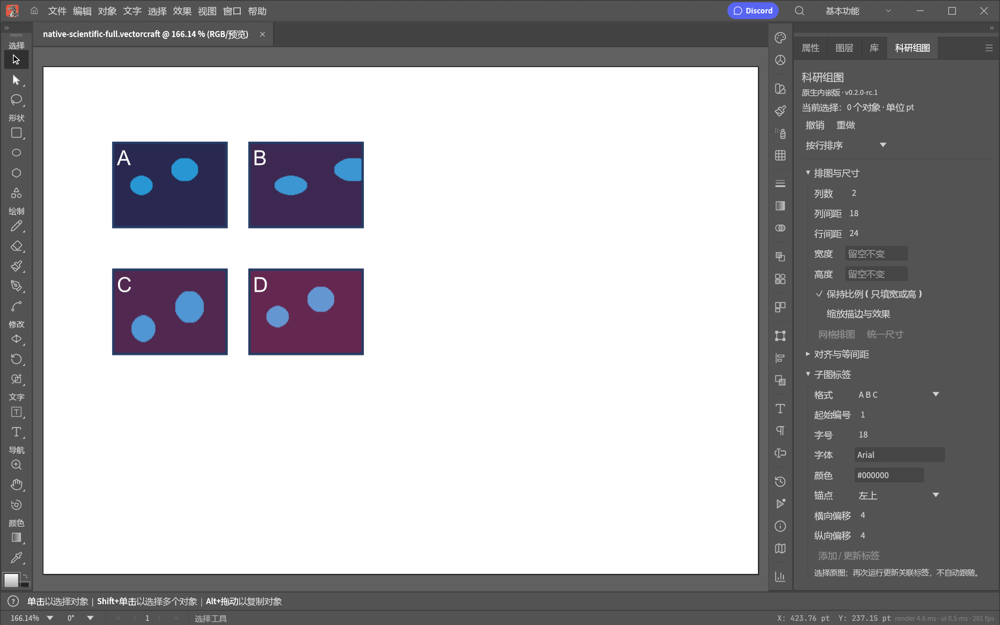

# 原生第二版候选验证记录

版本：0.2.0-rc.1。上游固定 VectorCraft v0.10.0（71174477cc056020fe712ae59901d76b870ca9d9）。此记录对应本地候选版，尚未作为 GitHub 第二版发行。

## 功能与真实桌面验证

先前 RC 构建已完成 75 项实际桌面检查：18 项停靠/浮动、排图、标签、撤销、保存重开；57 项完整功能、边界、预设重启、首版画稿兼容及实际按钮点击检查。全部使用合成示例；未修改用户已有画稿。

迁移功能包括尺寸、网格、对齐、净间距、标签、位置、边框和命名预设。重复生成标签/边框保留关联与对象ID；失败取消事务。标签、边框不会自动跟随原图。旋转和裁剪使用轴向几何边界。

独立设置目录为 `%APPDATA%\VectorCraftSCI`，不迁移官方设置。没有 Python 服务依赖；控制端口只用于专用测试会话，正常启动无需开放。

## 最终候选检查

最终路径脱敏二进制由 Rust 1.99.0 Windows GNU 工具链构建，另行完整通过 18 + 50 = 68 项桌面回归。便携包自身也实际启动并读取合成示例，确认独立设置目录、官方设置文件哈希未变、测试控制会话已退出。

- EXE SHA-256：`5bb36a7eb1fca95fd4da0fe2302f3fa1c3a588a71525f6744ada76c64e9081fe`。
- 333 项 Rust 依赖均附许可文件；缺失项为零。缺少随包许可的依赖从准确源码提交补齐，并记录来源网址。
- 发行 EXE 与压缩包检查 UTF-8 / UTF-16 本机用户名、私人目录；未检出。压缩包 CRC 完整性检查通过。
- 上游全套 CI：7 个阶段全部通过（格式、严格 Clippy、测试、资源、品牌、依赖分层、WebAssembly）；5,720 项测试通过，5 项上游测试忽略。

## 使用入口

运行便携包中的 VectorCraftSCI.exe，在右侧“属性 / 图层 / 库”旁选择“科研组图”，也可通过“窗口”菜单打开。分区可展开/收起，面板可滚动。选择多个图像或对象后执行所需操作；一次操作对应一次撤销。

支持范围和参数说明见 [原生版说明](../../native/README.md)。
