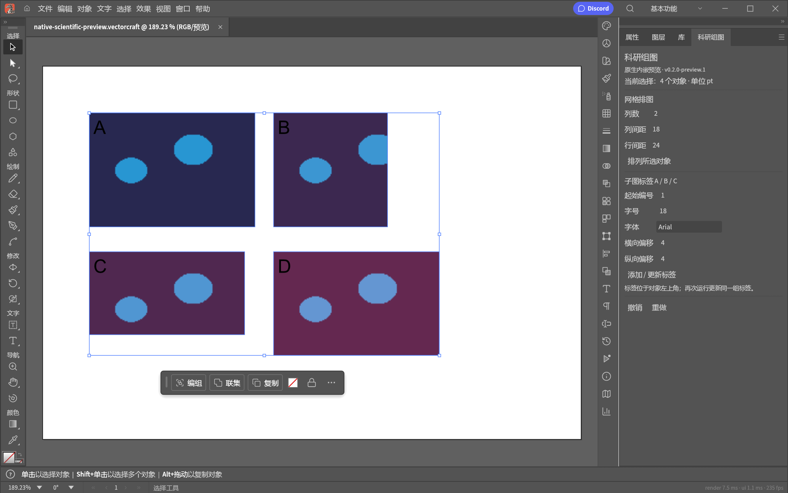

# 原生内嵌样例验证

版本：0.2.0-preview.1。日期：2026-10-15。Windows x64，基于官方 VectorCraft v0.10.0（commit `71174477cc056020fe712ae59901d76b870ca9d9`）。

## 已完成的本机验证

未修改上游的 release 基线构建成功；`--version` 返回 0.10.0，动态依赖检查只列出 Windows 系统 DLL。定制版同样成功编译，并实际运行在独立桌面窗口。

18 项可重复的真实桌面检查见 `scripts/smoke_native_desktop.py`：原生科研命令入口、四张嵌入图片的网格边界、对象/选择保留、单步撤销与重做、可编辑文字标签、重复更新保留标签 ID、更新实际文字、非法参数不改变画稿和历史、原生保存、重开、重开后关联、面板激活、浮动、停靠、重启恢复参数与标签、真实窗口截图。

另外在本机实际面板上完成 2 项坐标点击核验：

- 改列间距为 30 pt 并点击“排列所选对象”，右列实际移动 12 pt；恢复 18 pt 后再次点击恢复位置。
- 改起始编号为 3 并点击“添加 / 更新标签”，四个原有标签变为 C/D/E/F；恢复编号 1 后变回 A/B/C/D。

合计 **20 项本机检查通过**。示例仅使用自行生成的合成图片，不含用户科研原始数据。



## 复查方式

在专用测试窗口上运行，或让脚本启动自己的独立测试进程：

```powershell
python scripts/smoke_native_desktop.py --exe C:\Preview\VectorCraftSCI.exe --output C:\PreviewChecks
```

脚本只创建测试文档与输出，使用独立设置目录。只有脚本自己启动的进程会进行保存后退出/重启；外部指定的 `--port` 会话不会被关闭。坐标点击证据对应本机 1440×900 逻辑窗口，窗口布局变化时需重新定位，不能当作跨分辨率自动化保证。

## 当前边界

这是第一阶段的原生内嵌开发样例，不是完整第二版正式发行。尚未迁移首版尺寸、对齐/分布、完整标签格式/锚点/颜色、位置管理、边框与命名预设；组、裁剪、旋转对象的全面覆盖仍待后续验证。

当前记录是本机桌面证据。完整上游 CI、WASM 回归、干净环境重建、跨机运行、代码签名和正式公开前的打包隐私审查未完成。新增 Rust 单元测试已写入，当前交付依据是实际桌面检查，不声称完整测试套件已通过。

定制版以独立可执行文件和独立设置目录运行，原官方安装版仍保留。
